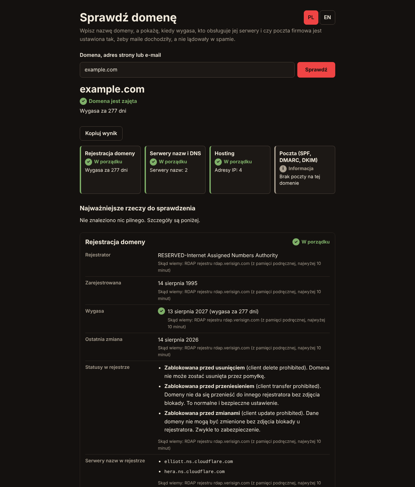
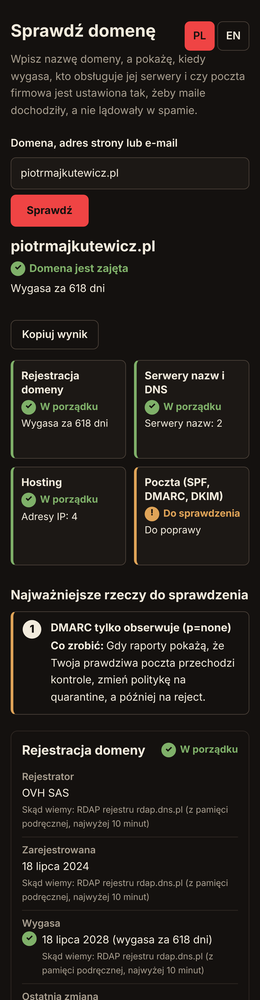
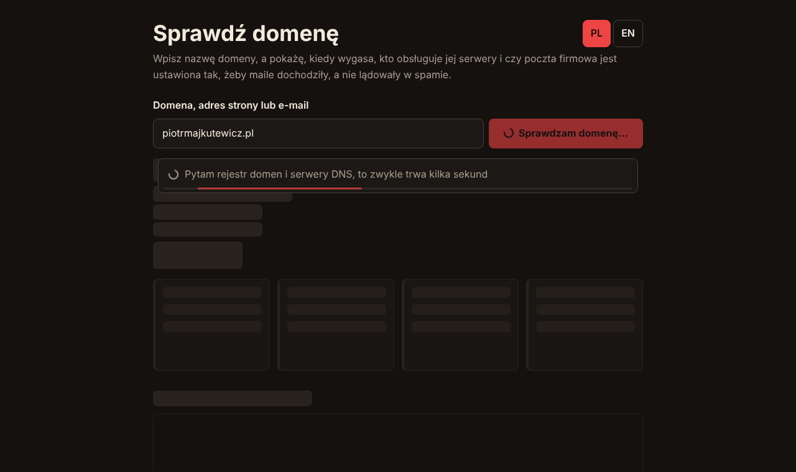
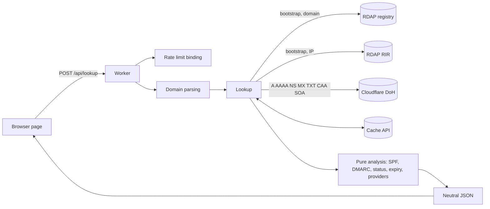

# Domain check for small businesses

A small Cloudflare Worker that takes a domain name (or a pasted web address or e-mail) and answers, in plain language: is the domain registered and when does it expire, who runs its name servers, which networks it points to, and is the company e-mail set up so that messages arrive instead of landing in spam. It is built for a business owner, yet stays honest about what the data can and cannot prove.



It is a portfolio project by Piotr Majkutewicz (full-stack developer and solution architect working with small businesses and startups): a conversation starter, not a replacement for a professional review.

| Mobile (390 px) | Loading state |
| --- | --- |
|  |  |

## Live demo

The demo is intended to run at <https://whois.piotrmajkutewicz.pl>. It is only live after the Worker has been deployed (see "Deploying"). It is **not indexed on purpose**: every response carries `X-Robots-Tag: noindex, nofollow`, the page has a `robots` meta tag, there is no sitemap, and `/robots.txt` allows crawling so that search engines can read the noindex signal.

## What it checks and where the data comes from

| Area | What | Source |
| --- | --- | --- |
| Registration | taken or free, registrar, registered / changed / expiry dates, statuses in plain words, name servers at the registry, DNSSEC, warning below 30 days (medium) and 7 days (high) and after expiry | RDAP of the registry, found through the IANA bootstrap file `data.iana.org/rdap/dns.json` |
| DNS | A, AAAA, NS, MX, TXT, CAA, SOA for the domain, A and AAAA for `www`, each with a one-line explanation | DNS-over-HTTPS JSON API of Cloudflare (1.1.1.1) |
| Providers | mail and DNS provider recognised from MX and NS host names (Google Workspace, Microsoft 365, OVHcloud, home.pl, cyber_Folks, nazwa.pl, Zoho, Cloudflare, ...) | pattern match on record values, labelled "recognised from records", never certainty |
| Hosting | the network each public address belongs to | RDAP of the regional internet registry (bootstraps `ipv4.json`, `ipv6.json`); shown as "the network the address belongs to", not "hosting by company X" |
| Mail | MX (incl. null MX), SPF (one record, ending `-all`/`~all`/`?all`/`+all`, nested `include` DNS lookups counted against the limit of 10, loops, syntax), DMARC (policy, `pct`, whether reports are set up), MTA-STS and TLS-RPT records, DKIM | DNS-over-HTTPS |

Mail gets a rating (well configured / needs improvement / at risk / no mail) and a list of findings with a level (high, medium, low), why it matters and what to do. Every piece of information says how we know it.

**DKIM** cannot be verified without the selector, which only the mail provider knows. The tool tries seven common selectors (`google`, `default`, `selector1`, `selector2`, `k1`, `dkim`, `mail`) and reports either "selector found" or "no common selectors found, which does not mean DKIM does not exist".

### What it does NOT do

- It does not use raw WHOIS over TCP (not possible on Workers, and RDAP is the successor protocol over HTTPS).
- It does not show the domain owner: no names, addresses, phone numbers or e-mails (see below), no domain history, no valuation, no search rankings, no HTTPS certificate validity of the website, and it cannot prove that a given e-mail will arrive (that needs a test message).
- It does not check MTA-STS policy files, only that the DNS record exists.
- It does not log visitors, set cookies or use analytics.

### GDPR and personal data

Registries often return contact data, even when a record is marked "redacted": a real `.pl` answer for a sole proprietor included name, street and phone number. The parser therefore reads a **fixed whitelist** of fields only (registrar name from the entity with the `registrar` role, event dates, statuses, name servers, DNSSEC flag). Registrant, administrative, technical and abuse contacts are never read, so they cannot leak, and a test checks this with fixtures that contain such data. DMARC report addresses are reduced to a count. For IP networks only organisation names (vCard kind `org`) are used, never people. The page tells the visitor that owner data is hidden.

### Registry limits

Registries rate-limit. NASK (`rdap.dns.pl`, `.pl`) answered with HTTP 429 after a few quick requests, and its data may be up to 15 minutes behind the registry. The Worker handles this:

- successful registry answers (and "not found") are cached per domain for 10 minutes in the Cache API, bootstrap files for 1 hour;
- one retry after a short backoff (`Retry-After` of up to 2 s is respected) for 429, 5xx and network errors;
- a persistent 429 becomes a friendly "the registry is limiting requests for now, try again in a moment" and is cached for 30 seconds so that repeated clicks do not hammer the registry; DNS and mail are still checked and shown;
- parallel lookups of the same domain in one isolate share a single registry query;
- a per-visitor limit (8 lookups per minute per IP) protects both the registries and the Worker;
- "not found" is only believed when the registry answers 404 with a JSON body; an HTML 404 or any other error is reported as "could not get data", never as "free". Even a real "not found" is worded as "looks available".

Endings without an RDAP service (not in the bootstrap file) get an honest "this registry does not share data through RDAP", and DNS is still shown.

## Languages

The UI is in Polish by default, whatever the browser language is. The PL / EN switch in the header (a button group with `aria-label` and `aria-pressed`, 44 px targets) changes the language. The choice is kept in `localStorage` (the page works without it); `?lang=pl|en` in the address wins and `<html lang>` follows. Switching **never repeats the lookup**: the API returns language-neutral data (ids, parameters, values) and the page renders texts from the two dictionaries embedded in it (`src/i18n/pl.ts`, `src/i18n/en.ts`).

### API

`POST /api/lookup` with `{"domain": "example.pl", "lang": "pl" | "en"}` (`lang` optional, default `pl`; `?lang=` is used for errors before the body is read).

```json
{
  "lang": "pl",
  "neutral": { "domain": "example.pl", "registration": { "state": "registered", "daysToExpiry": 618 }, "mail": { "rating": "improve" }, "findings": [ { "key": "dmarc.policy_none", "section": "mail", "severity": "medium", "source": "doh", "params": {} } ], "top": [0] },
  "texts": { "status": "Domena jest zajęta", "mailRating": "Do poprawy", "top": ["..."], "findings": [ { "id": "dmarc.policy_none", "title": "...", "why": "...", "fix": "...", "source": "..." } ] }
}
```

Errors are `{"error": {"code", "key", "message"}}` with stable codes (`invalid_domain`, `invalid_json`, `invalid_lang`, `body_too_large`, `rate_limited`, `method_not_allowed`, `not_found`, `internal_error`) and translated messages. Internal details are never returned.

Input rules: a domain, URL or e-mail address is accepted and reduced to the registrable domain (`www.example.pl` becomes `example.pl`); IDN works through the URL API (punycode), and the readable form is shown. IP addresses (any notation), `localhost`, local names, names without a dot, over-long names and invalid characters are rejected. The registrable domain uses a **simplified public suffix list** (`src/psl.ts`): `.pl` functional and regional zones (`com.pl`, `waw.pl`, ...) and common second-level zones such as `co.uk`. It is not the full Public Suffix List, so for a suffix missing there the result may be one label too high. Add suffixes to that file.

## Architecture



- `src/domain.ts`, `rdap.ts`, `dns.ts`, `spf.ts`, `dmarc.ts`, `providers.ts`, `ip.ts`, `analyze.ts`: pure logic, no I/O, tested offline on fixtures.
- `src/net.ts`: all outbound requests go through one place with a budget of 30 requests per lookup, 4 s per call, 12 s in total and 6 concurrent requests. SPF `include` walking stops as soon as the count passes 10 and uses what budget is left; if the budget or time runs out the result says "incomplete" instead of guessing. Private, loopback, link-local and other special addresses found in DNS are never queried.
- `src/registry.ts`, `src/lookup.ts`: RDAP clients, caching, retry, de-duplication and orchestration.
- `src/index.ts`, `src/ui.ts`: routes and the single HTML page (no external resources, no front-end libraries; external data is inserted with `textContent` only).

### Decisions

- **RDAP instead of raw WHOIS**: Workers cannot open TCP connections, RDAP is structured JSON over HTTPS, and it makes redaction explicit.
- **Cache API instead of a database**: no state to manage, no storage of anything about visitors. The code falls back to an in-memory cache where the Cache API does not exist (tests; note the Cache API only works on custom domains, not on `workers.dev`).
- **Neutral API plus client-side texts**: language changes are instant and cost nothing.
- **Honesty over completeness**: when something cannot be determined the result says so (failed query is never reported as "missing record").

## Security

CSP with a per-request nonce and `default-src 'none'`; `X-Content-Type-Options`, `Referrer-Policy: no-referrer`, `X-Frame-Options: DENY`, HSTS, `Permissions-Policy`; `X-Robots-Tag: noindex, nofollow` on every response; strict domain validation; request body limited to 2 KB; rate limiting per IP (`ratelimits` binding, code works without it locally); no cookies, no analytics, no logging of visitors. iOS: the page sets `theme-color`, `color-scheme: dark` and `html{background:#14110f}`, never uses `overflow` on `html` or `body` and never moves the scroll position while the user scrolls. `?dbg=1` turns on an on-screen scroll/touch log for diagnosing a real phone; it is inactive otherwise.

## Running and testing

```sh
npm ci
npm run dev            # wrangler dev, http://127.0.0.1:8787
npm run typecheck
npm test               # unit and route tests, fully offline
```

Browser tests need Playwright (not a dependency): `npm i -g playwright`, start `npx wrangler dev --port 8970`, then `node test/e2e/ui.e2e.mjs http://127.0.0.1:8970` (`npm run test:e2e` uses the default address). They cover the loader within 100 ms, layout stability, language switch without a new request, no English words in the Polish view and no Polish letters in the English one, reduced motion, error states, and real touch gestures on an iPhone 13 emulation (via DevTools protocol, after a control page proves the gestures scroll) at 390 and 360 px, plus desktop at 1280 px. Set `PLAYWRIGHT_MODULE` if Playwright is not resolvable, `E2E_SHOTS_DIR` to save screenshots and `E2E_LIVE=1` for a few real lookups (spaced out; keep it small because of registry limits). The dev server applies the rate limit of 8 lookups per minute, so wait a minute between full runs. `test/e2e/screenshots.mjs` produces the images in `docs/`.

## Deploying

`wrangler.jsonc` contains no account ids or secrets. Log in with `npx wrangler login` and run `npm run deploy`; the custom domain `whois.piotrmajkutewicz.pl` is created on deploy (the zone must be on the same Cloudflare account). The manual GitHub workflow (`.github/workflows/deploy.yml`) needs the repository secrets `CLOUDFLARE_API_TOKEN` and `CLOUDFLARE_ACCOUNT_ID` and verifies them before deploying.

## Extending

- **A new check**: add a pure function in `src/analyze.ts` that returns findings (`key`, `section`, `severity`, `source`, `params`), feed it the data in `src/lookup.ts`, add the key to `FINDING_KEYS` in `src/i18n/types.ts` and a text in both dictionaries. The tests fail until every key has both texts and is produced by some scenario.
- **A new language**: add it to `Lang` and `LANGS`, create a dictionary typed `Dictionary` (the compiler demands every key), register it in `src/i18n/index.ts` and add a button in `src/ui.ts`.
- **A new provider**: add an entry to `src/providers.ts`.

## License

MIT, see [LICENSE](LICENSE).
